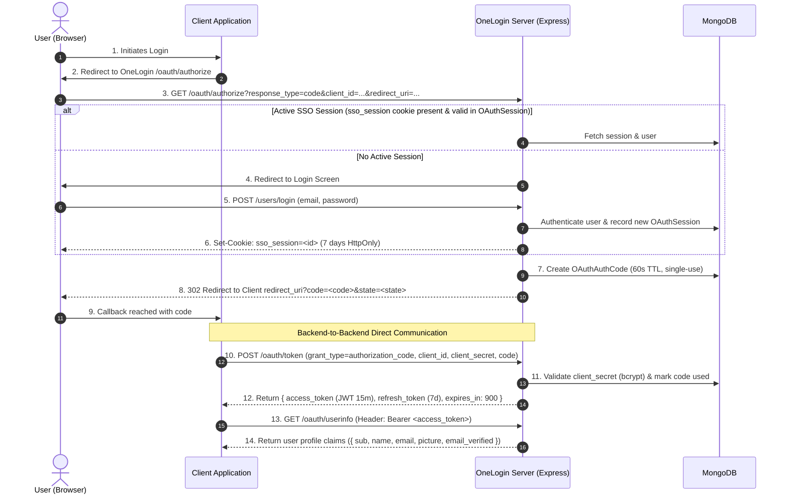

# OneLogin Architecture & Developer Reference

This document provides a single-source-of-truth technical overview of the **OneLogin** project. It is designed so that developers and AI assistants can quickly understand the system's architecture, data models, workflows, endpoints, and runtime quirks without needing to re-index the entire repository each time.

---

## 1. Executive Summary

- **Project Name**: OneLogin
- **Type**: Centralized Identity Provider (IdP) & Single Sign-On (SSO) Server
- **Core Standard**: OAuth 2.0 Authorization Code Grant Flow
- **Runtimes & Frameworks**: Node.js (Express.js), MongoDB (Mongoose), Firebase Realtime Database
- **Code Intelligence**: CodeGraph index initialized (`.codegraph/`)

OneLogin enables third-party client applications to authenticate users securely via an OAuth 2.0 Authorization Code flow. It maintains a central browser session (`sso_session` cookie) to grant single-sign-on access across connected clients, and issues short-lived JWT access tokens and long-lived refresh tokens for microservice backends.

---

## 2. Architecture & Data Flow



---

## 3. Database Schema Reference

### 3.1 MongoDB Models (`src/model/`)

| Model | File | Primary Fields | Purpose |
|---|---|---|---|
| **User** | `src/model/User.js` | `name`, `email` (unique), `password` (hashed), `phone`, `isVerified`, `userImage`, `tokens: [{ token }]` | User account records and active direct login tokens. |
| **OAuthClient** | `src/model/oauth/OAuthClient.js` | `client_id` (unique), `client_secret` (bcrypt hash), `app_name`, `redirect_uris: [String]`, `allowed_scopes: [String]` | Registered third-party client applications. |
| **OAuthAuthCode** | `src/model/oauth/OAuthAuthCode.js` | `code` (unique), `user_id` (ref User), `client_id`, `redirect_uri`, `expires_at` (60s), `used` (bool) | Ephemeral authorization codes exchanged for tokens. |
| **OAuthSession** | `src/model/oauth/OAuthSession.js` | `session_id` (unique), `user_id` (ref User), `expires_at` (7 days) | Central SSO cookie sessions. |
| **OAuthToken** | `src/model/oauth/OAuthToken.js` | `access_token` (JWT), `refresh_token`, `user_id` (ref User), `client_id`, `expires_at` (15m), `refresh_expires_at` (7d) | Issued OAuth tokens with refresh lifecycle. |
| **QRCode** | `src/model/QRCode.js` | `code` (UUID), `token` (String) | Cross-device QR companion authentication state. |
| **VerificationLink** | `src/model/VerificationLink.js` | `email` | Email verification token links. |
| **Developer** | `src/model/Developer.js` | `developerName`, `developerImage`, `createdBy`, `userId` | Developer entity for project management. |

### 3.2 Firebase Realtime Database (`src/database/FirebaseHelper.js`)
Used for developer project configuration:
- `developer/{developerId}/details/securityKey`: Developer API key.
- `developer/{developerId}/projects/{projectId}/details`: Contains `name`, `api`, `admin`, `maintenance` (bool), `verification` (bool), `developer: [ids]`.

---

## 4. API Endpoints Map

### 4.1 OAuth 2.0 (`/oauth`)
- `GET /oauth/authorize`: Initiates authorization code flow.
  - Query: `client_id`, `redirect_uri`, `response_type=code`, `state` (opt), `scope` (opt).
  - Validates client and allowed redirect URIs. Checks `sso_session` cookie.
- `POST /oauth/token`: Token exchange & renewal.
  - Body (`authorization_code`): `{ grant_type: "authorization_code", client_id, client_secret, code, redirect_uri }`
  - Body (`refresh_token`): `{ grant_type: "refresh_token", client_id, refresh_token }`
  - Returns: `{ access_token, token_type: "Bearer", expires_in: 900, refresh_token }`
- `GET /oauth/userinfo`: Returns profile claims for the bearer token.
  - Header: `Authorization: Bearer <access_token>`
  - Returns: `{ sub, name, email, picture, email_verified }`
- `POST /oauth/revoke-token`: Revokes an access or refresh token.
  - Body: `{ token, token_type_hint: "access_token" | "refresh_token" }`
- `POST /oauth/register-client`: Admin client registration.
  - Header: `x-admin-secret: <ADMIN_SECRET>`
  - Body: `{ app_name, redirect_uris: [...], allowed_scopes: [...] }`
  - Returns: `{ client_id, client_secret }` (plain secret shown once)

### 4.2 Direct Authentication (`/users`)
- `POST /users/create`: Sign up a new user account.
- `POST /users/login`: Authenticate email/password. Sets `sso_session` cookie and returns direct JWT.
- `POST /users/logout`: Revoke current device token from `User.tokens`.
- `POST /users/logout/all`: Clear all device tokens for user.
- `POST /users/logout/all/current`: Clear all device tokens except current.
- `POST /users/logout/device`: Revoke a specific token passed in request body.
- `POST /users/verification/email`: Send verification email via `freely-email`.
- `GET /users/verification/email/:id`: Complete email verification.
- `GET /users/check/login`: Verifies if token is valid.
- `GET /users/isVerified`: Returns email verification status.
- `GET /users/profile`: Returns user profile object.

### 4.3 QR Code Authentication (`/users/login/qr`)
- `POST /users/login/qr/store`: Desktop initiates; generates UUID stored in `QRCode` model.
- `POST /users/login/qr/storetoken`: Mobile (already logged in with `userAuth`) scans QR and stores newly issued token.
- `POST /users/login/qr/validate`: Desktop polls; when token is present, consumes token and deletes `QRCode` entry.

### 4.4 Developer & Projects (`/developer`)
- `POST /developer/project/create`: Creates project in Firebase RTDB.
- `POST /developer/project/get`: Retrieves project config.
- `PATCH /developer/project/update/general`: Updates project properties (`name`, `email`, `maintenance`, `verification`).

---

## 5. Security & Middlewares

1. **`oauthAuth.js`**:
   - Extracts `Bearer <token>` from `Authorization` header.
   - Verifies JWT signature using `JWT_SECRET`.
   - Checks MongoDB `OAuthToken` to guarantee the token has not been revoked.
   - Populates `req.user`, `req.client_id`, `req.token`.
2. **`userAuth.js`**:
   - Used for direct user API access.
   - Verifies user's token against the `User.tokens` array in MongoDB.
   - Enforces `user.isVerified === true`.
3. **`validate.js`**:
   - Zod schema validator that intercepts invalid body/query/params before hitting controllers.
4. **`errorHandler.js`**:
   - Centralized handler formatting operational `ApiError` instances into clean `{ code, message }` JSON responses.

---

## 6. Security Hardening & Implemented Protections

The codebase has undergone defensive hardening with the following protections in place:

| Protection / Fix | Implementation | Details |
|---|---|---|
| **OAuth 2.0 PKCE (RFC 7636)** | `OAuthAuthCode.js`, `oauthController.js`, `tokenService.js` | Supports `code_challenge`, `code_challenge_method=S256`, and verifies `code_verifier` during token exchange. |
| **Rate Limiting** | `src/middlewares/rateLimiter.js` | Applied to `/users/login` (15/15m), `/oauth/token` (15/15m), `/users/verification/email` (5/15m), and `/users/login/qr/validate` (60/m). |
| **SSO Session Revocation** | `src/controllers/logoutController.js` | Deletes `OAuthSession` records from MongoDB and clears `sso_session` cookie upon logout. |
| **Cookie Hardening** | `src/controllers/authController.js` | Configures `sameSite: "lax"`, `httpOnly: true`, and conditional `secure` on the `sso_session` cookie. |
| **Admin Secret Timing Protection** | `src/controllers/oauth/oauthController.js` | Uses `crypto.timingSafeEqual` and disallows weak fallbacks in production. |
| **QR Code Expiration TTL** | `src/model/QRCode.js`, `src/controllers/qrController.js` | Enforces 2-minute expiration with MongoDB TTL indexes and controller checks. |
| **Cryptographic Email Tokens** | `src/model/VerificationLink.js`, `src/controllers/verificationController.js` | Uses 32-byte crypto random tokens with a 24-hour expiration TTL index. |
| **Firebase Credential Fallback** | `src/database/firebaseConfig.js`, `FirebaseHelper.js` | Supports `FIREBASE_SERVICE_ACCOUNT` via env and guards uninitialized database calls. |
| **Resolved Runtime Bugs** | `User.js`, `userAuth.js`, `stringHelper.js` | Fixed `findByCredentials` method typo, implemented missing `stringHelper`, and normalized `JWT` env casing. |

---

## 7. Development & Testing Commands

- **Start Local MongoDB & Mongo Express**:
  ```bash
  docker-compose up -d
  ```
- **Start Dev Server**:
  ```bash
  npm run dev
  ```
- **Run OAuth Test Script**:
  ```bash
  node test-oauth.js
  ```
- **CodeGraph Status / Context**:
  ```bash
  codegraph status
  codegraph query <symbol>
  codegraph explore <area>
  ```
